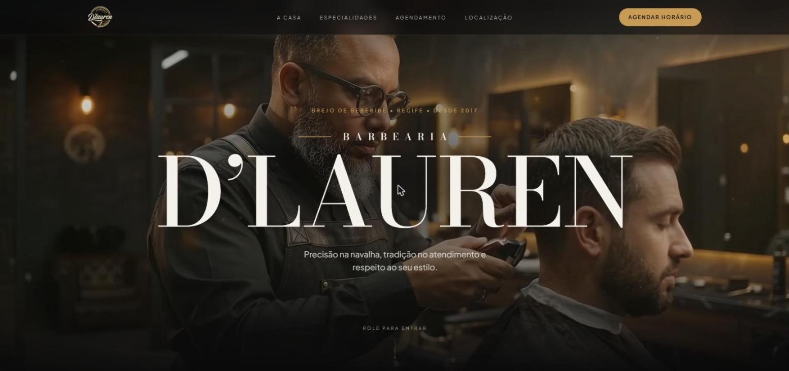
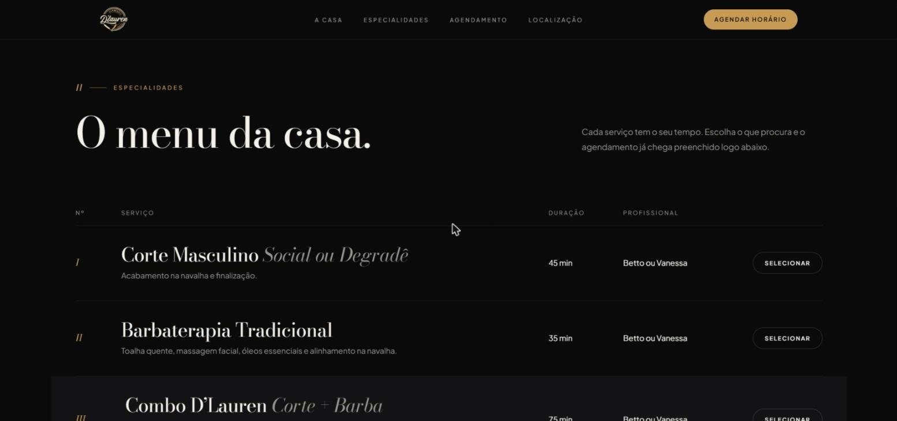
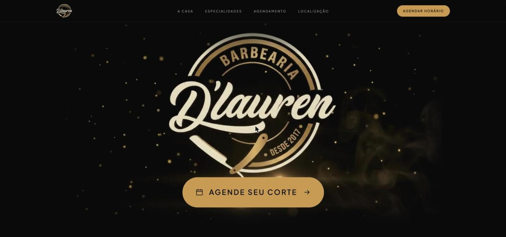
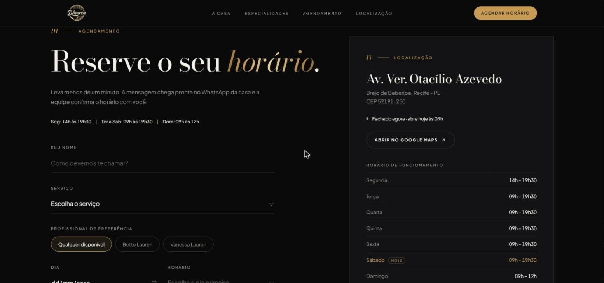
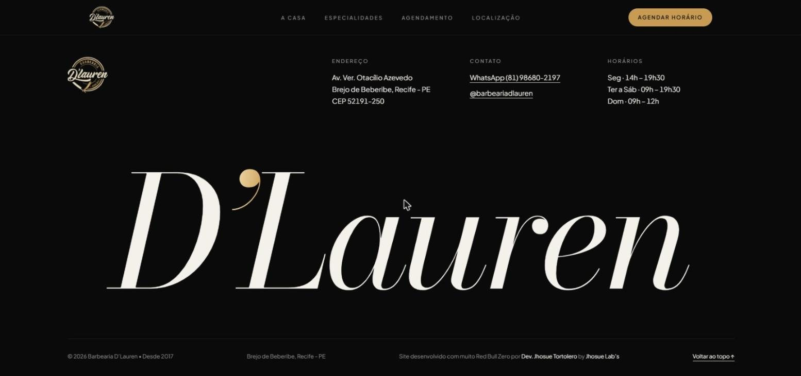
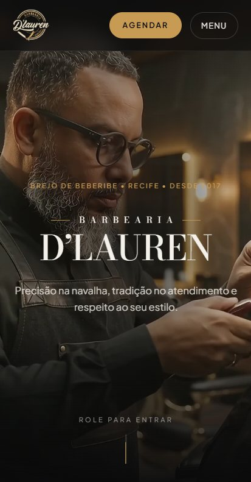

<div align="center">



# Barbearia D’Lauren — Desde 2017

**Site cinematográfico da Barbearia D’Lauren, no Brejo de Beberibe, Recife - PE.**<br>
Dois filmes controlados pela rolagem, agendamento direto no WhatsApp e acabamento de estúdio.

[**Ver o site ao vivo →**](https://jhosuetortolero-lgtm.github.io/barbearia-dlauren/)


</div>



---

## Sobre o projeto

A **Barbearia D’Lauren** atende o Brejo de Beberibe desde 2017, com corte masculino, degradê, barbaterapia e o **Primeiro Corte** infantil, conduzidos por **Betto e Vanessa Lauren**.

O site conta essa história como um filme: o visitante rola a página e controla, quadro a quadro, o vídeo do barbeiro em atendimento (abertura) e o vídeo da logo dourada (encerramento). No fim, um toque leva ao agendamento, que chega pronto no WhatsApp da casa.

## Destaques

| | |
|---|---|
| **Scroll-scrubbing duplo em `<canvas>`** | 94 frames no hero e 240 frames no encerramento, sincronizados com a rolagem (`scrub: 0.5`), com suporte a telas Retina (DPR até 2). |
| **Carregamento inteligente** | O preloader baixa apenas os frames do hero. Os frames da logo carregam em segundo plano assim que o visitante sai do hero (6 downloads simultâneos). |
| **CTA rastreado no vídeo** | O vídeo da logo já traz um botão "Agende seu Corte" gravado. A posição dele foi medida quadro a quadro e o botão real em HTML (clicável e acessível) o cobre durante todo o movimento de câmera. |
| **Agendamento no WhatsApp** | Formulário com serviço, profissional, dia e horário. Os horários seguem o funcionamento real e avisam quando o período é de maior procura (quinta à tarde e sexta). A mensagem já sai formatada para `wa.me`. |
| **Status "aberto agora"** | Calculado no fuso de Recife (UTC−3), com o dia de hoje destacado na tabela de horários. |
| **Feito para celular** | Em telas em pé, o site carrega versões recortadas dos mesmos quadros (mesma nitidez, ~45% menos memória e download), essencial para a rolagem fluir no iPhone e no Android. |
| **Movimento reduzido** | Com "Reduzir movimento" ligado no aparelho (`prefers-reduced-motion`), o filme continua respondendo à rolagem, porque cada quadro é controlado pelo próprio visitante, mas saem a rolagem suave, os deslizamentos e as animações automáticas. |
| **Fusão perfeita com o fundo** | Os frames têm preto puro; o canvas usa composição `lighten` para fundi-los ao `#0A0A0B` da página, sem emenda visível. |

## Galeria

| Especialidades | Encerramento |
|---|---|
|  |  |
| **Agendamento & Localização** | **Footer** |
|  |  |

<p align="center"></p>

## Design system

| Token | Valor | Uso |
|---|---|---|
| Fundo | `#0A0A0B` | Preto carvão, fundido ao fundo dos frames |
| Superfície | `#131315` | Cards e painel de localização |
| Hairline | `rgba(255,255,255,0.08)` | Divisórias de 1px |
| Ouro fosco | `#C89B54` | Destaques, CTAs e numerais (com variação metálica nos acentos) |
| Texto | `#F4F1EA` / `#96948E` | Off-white quente / texto secundário |
| Títulos | **Bodoni Moda** | Didone de alto contraste, corte óptico ajustado para tela |
| Interface | **Plus Jakarta Sans** | Navegação, formulário, horários (`tabular-nums`) |

Animações com desaceleração orgânica (`power3.out` / `cubic-bezier(0.16, 1, 0.3, 1)`), sem `bounce` ou `elastic`.

## Estrutura

```
.
├── index.html                 # Página única, HTML semântico
├── assets/
│   ├── css/site.css           # Design system e layout
│   └── js/site.js             # Sequências de frames, cenas GSAP, Lenis, agendamento
├── public/
│   ├── logo-dlauren.png       # Logo (preloader, navbar, footer, favicon) — 360px
│   ├── frames-barber/         # 94 frames WebP 1920×1080 — hero
│   ├── frames-barber-mobile/  # 94 frames 640×1080 — hero no celular em pé (recorte central)
│   ├── frames-logo/           # 240 frames WebP 1280×720 — encerramento
│   └── frames-logo-mobile/    # 240 frames 760×720 — encerramento no celular em pé
├── source/
│   ├── videos/
│   │   ├── Barbeiro01.mp4     # Vídeo original do hero (barbeiro em atendimento)
│   │   └── Barbeiro02.mp4     # Vídeo original do encerramento (logo D’Lauren)
│   └── logo-dlauren-680.png   # Logo em resolução cheia, extraída do vídeo
├── tools/
│   ├── extract-frames.sh      # Gera os frames WebP a partir dos vídeos
│   ├── extract_logo.py        # Gera o PNG transparente da logo a partir do vídeo
│   └── track_cta.py           # Mede a posição do botão gravado no vídeo (CTA_TRACK)
└── docs/                      # Imagens deste README e da prévia de compartilhamento
```

## Configuração

Tudo o que costuma mudar fica no topo de [`assets/js/site.js`](assets/js/site.js):

```js
const HERO_TOTAL_FRAMES = 94;          // arquivos em public/frames-barber/
const CLOSING_TOTAL_FRAMES = 240;      // arquivos em public/frames-logo/
const WHATSAPP_NUMBER = "5581986802197";

const HERO_SECTION_VH = 250;           // altura total da seção pinada (inclui a 1ª tela)
const CLOSING_SECTION_VH = 320;
```

Os horários de funcionamento ficam na constante `HOURS` do mesmo arquivo (e na tabela do `index.html`).

## Rodar localmente

Os frames são carregados por URL, então use um servidor local (abrir o arquivo direto também funciona, mas o servidor reproduz o comportamento real):

```bash
python -m http.server 8080
# ou
npx serve .
```

Depois acesse `http://localhost:8080`.

## Ferramentas — recriar os assets a partir dos vídeos

Tudo o que o site usa pode ser gerado de novo a partir de `source/videos/`. Requisitos: [FFmpeg](https://ffmpeg.org/) no PATH e, para os scripts Python, `pip install pillow numpy`. Rode os comandos na raiz do projeto.

**1. Frames WebP** (24 fps, qualidade 82; hero em 1920px, logo na resolução nativa de 1280px):

```bash
bash tools/extract-frames.sh
# ou com outros vídeos:
bash tools/extract-frames.sh caminho/hero.mp4 caminho/logo.mp4
```

O script apaga e recria `public/frames-barber/`, `public/frames-logo/` e as versões `-mobile` (recortes centrais usados no celular em pé) e mostra quantos frames gerou. Se o número mudar, atualize `HERO_TOTAL_FRAMES` e `CLOSING_TOTAL_FRAMES`.

**2. Logo transparente** (escolhe o quadro mais limpo do vídeo, remove partículas e recupera o alfa do fundo preto):

```bash
python tools/extract_logo.py --full source/logo-dlauren-680.png
```

**3. Posição do botão gravado no vídeo da logo** (gera a constante `CTA_TRACK` para colar em `assets/js/site.js`):

```bash
python tools/track_cta.py
```

O botão do vídeo entra com um fade antes de o texto ficar legível; por isso o primeiro item de `CTA_TRACK` no site (frame `192`) foi extrapolado a partir do movimento dos frames seguintes. Se o vídeo da logo for trocado, rode o script e revise esse primeiro item.

## Como funciona por dentro

- **Lenis + ScrollTrigger**: o Lenis é atualizado pelo `gsap.ticker` e repassa cada rolagem ao `ScrollTrigger.update`. As cenas são criadas depois que fontes e frames do hero carregam, e a página usa `scrollbar-gutter: stable` para que a largura medida pelos pins nunca mude.
- **Frames**: cada sequência mantém um cache de imagens decodificadas e, se um quadro ainda não chegou, desenha o mais próximo disponível.
- **Celular**: `site.js` detecta tela em pé (largura < 768px) e troca para `frames-*-mobile`. No encerramento, a escala é limitada pela largura para a logo caber inteira, e o botão rastreado é deslocado pelo recorte (`offsetX`).
- **Sem JavaScript**: conteúdo, links e contato continuam acessíveis; o agendamento aponta direto para o WhatsApp.

## Créditos

Desenvolvido com muito **Red Bull Zero** por **Dev. Jhosue Tortolero** — **Jhosue Lab’s**.

Marca, logotipo, vídeos (inclusive os originais em `source/videos/`) e imagens pertencem à **Barbearia D’Lauren**. O uso desses materiais fora deste site depende de autorização da barbearia.

<div align="center">

**Barbearia D’Lauren** · Av. Ver. Otacílio Azevedo — Brejo de Beberibe, Recife - PE · [@barbeariadlauren](https://www.instagram.com/barbeariadlauren/)

</div>
